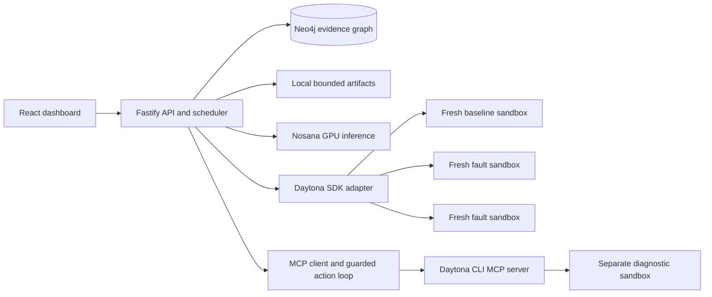

# Entropy — archived repository-QA plan

Written: 2026-10-31. Budget: two people directing coding agents, 4–5 hours.
Status: SUPERSEDED. Kept as design history only. The owner selected the cascade demo after pulling `.spec`; follow `spec/README.md` and `spec/plan.md` instead. Do not implement this archived plan.

## 0. Start here

Build a working demonstration of **controlled chaos testing in disposable environments, with a graph of the observed failures**.

Product sentence:

> Entropy runs your tests in fresh Daytona sandboxes, introduces controlled dependency faults, and shows which behaviors break, with evidence stored in Neo4j and analysis powered by Nosana GPUs.

Read this file once, implement the assigned lane in section 14, and use the contracts below. Do not redesign the architecture or add frameworks. Begin with the sponsor connectivity checks, then produce one real vertical slice before expanding the UI.

### Decisions and assumptions

| Item | Decision | Basis |
| --- | --- | --- |
| Implementation | TypeScript backend and React dashboard | Chosen for shared contracts, integration speed, and visual presentation; the product owner prioritizes result over personal language familiarity. |
| Nosana | Hosted GPU inference proposes/ranks supported experiments and explains measured results | User accepted inference as Nosana's role; the backend holds orchestration credentials. |
| Daytona SDK | Deterministic sandbox lifecycle and experiment execution | User accepted SDK execution. |
| Daytona MCP | A bounded investigation agent inspects artifacts and reruns a test in a separate diagnostic sandbox | User accepted MCP investigation alongside SDK execution. |
| Initial target | One small checkout application in `examples/checkout` within this Git repository | Explicit planning assumption: no external target URL was supplied. This is the supported repository fixture, with genuine application code, HTTP calls, and tests. |
| Repository support claim | One configured Node.js target in a real Git checkout | Do not claim arbitrary repository/language discovery. The configuration boundary permits more targets later. |
| Hosting | Local dashboard and long-lived local backend; sponsor services are remote | Public hosting is unnecessary for the first demonstration. |
| Sponsor credentials | Availability is unverified | Owner supplies credentials locally during the initial gate; never place secrets in this document or Git. |

The default target lives inside Entropy to avoid spending the hackathon creating and coordinating a second repository. In the demonstration, label it **“Entropy checkout demo”**. A campaign must execute a recorded immutable Git revision, including the target directory; it must not test an arbitrary copy of untracked local files. A separate existing target would need its own configuration and dependency topology, and is outside this first build.

### Completion means

- [ ] A real clean baseline passes all six target tests in a newly created Daytona sandbox.
- [ ] Three single-fault experiments run in fresh sandboxes; at least two overlap in time when account quota permits.
- [ ] The same source revision, dependency lock, runtime, and test inputs are used across baseline and faults.
- [ ] Every fault has an application-level witness proving it was exercised.
- [ ] The UI shows baseline results, per-experiment deltas, sandbox IDs, and evidence.
- [ ] Neo4j persists the run, topology, experiments, individual test observations, and analysis provenance.
- [ ] Selecting a failure highlights its target dependency and the affected test/component paths.
- [ ] At least one actual Nosana inference response contributes to the run, and its model/source are recorded.
- [ ] An investigation executes at least one real Daytona MCP tool call against a separate diagnostic sandbox, with a visible trace.
- [ ] Reproduction reruns an experiment in another fresh sandbox without replacing the original evidence.
- [ ] Sandboxes are deleted after evidence collection, including failed/cancelled work; unresolved cleanup is visible.
- [ ] A second clean run passes without leftover state from the first campaign.

All three sponsors must be real in the final live demonstration. Explicitly labeled development fixtures are allowed while independent parts are built; fixtures do not satisfy completion.

## 1. Scope and scientific claims

The MVP performs **dependency fault injection and controlled regression comparison**. Disposable sandboxes reduce contamination from previous runs. Reproducibility additionally requires an immutable source bundle, pinned dependencies/runtime, deterministic data, and a recorded experiment specification. External provider availability can still vary.

A single passing baseline and a changed test outcome are evidence of an observed regression under a particular intervention. They do not prove every inferred root cause, universal causality, or a statistical flakiness rate. The UI must distinguish:

- **Observed:** the fault was applied, the relevant request hit it, and these tests changed outcome.
- **Configured topology:** known component relationships declared in the target configuration.
- **AI hypothesis:** an explanation or suggested fix, accompanied by evidence references.
- **Reproduced:** a separate fresh execution showed the same new failure for the same manifest.

Explicitly exclude from v1: arbitrary codebase onboarding, private-repository auth, production fault injection, Kubernetes, privileged network manipulation, CPU/memory exhaustion, automatic code fixes, package-manager-wide mutation, distributed workers, accounts/billing, GitHub webhooks, a conversational chatbot, and model hosting infrastructure.

Package drift is a later extension: prepare two explicit package/lockfile pairs, record the intended package version change, install each with `npm ci`, and compare the identical application source. Never edit `package.json` alone and keep a stale lockfile. Response-schema drift in this MVP is an external API contract change, not a claim that package drift has been implemented.

## 2. User journey and demonstration

One page is sufficient, with a run list/detail view and an investigation drawer.

1. Open Entropy. See the supported target, pinned revision, sponsor connection status, and a short description of the experiment suite.
2. Click **Run chaos suite**. Backend returns a run ID immediately; browser polls progress.
3. See a passing baseline, followed by cards for dependency outage, latency, and response-schema drift. Show real start/end times and sandbox IDs.
4. Watch experiment results populate a test comparison table and the graph.
5. Click the inventory outage card: graph highlights Inventory → Catalog/Checkout → their failing tests. Open the assertion and fault witness.
6. Read a concise Nosana-generated explanation with links to the exact observations it used.
7. Click **Reproduce**. A child experiment gets a new sandbox and its own results; show whether the failure repeated.
8. Click **Investigate with agent**. A separate diagnostic sandbox is prepared, the agent reads evidence through Daytona MCP, and can rerun one selected test. Display the tool trace and evidence-grounded hypothesis.
9. End with all sandbox cleanup statuses visible. Saved results remain available after backend restart.

Suggested 90-second pitch: “The clean run passed. We changed only Inventory availability, and these two behaviors failed. The graph connects the dependency to the tests we observed breaking. This independent run reproduced it. Nosana explains the evidence, and our agent uses Daytona MCP to inspect the failure.” Do not promise a particular live run duration until it has been measured.

## 3. Fixed technical architecture

### Stack

| Area | Use |
| --- | --- |
| Runtime | Node.js 22; resolve and record the exact sandbox Node/npm versions during setup |
| Workspace | npm workspaces; one root lockfile for the product, a separate standalone lockfile inside the target |
| Backend | Fastify + TypeScript + `tsx` for development |
| Validation/contracts | Zod schemas with inferred TypeScript types in `packages/contracts` |
| Database | Official `neo4j-driver`; Aura if available, otherwise local Neo4j Community through Docker Compose |
| Frontend | React + Vite + TypeScript; plain CSS; `@xyflow/react` for a graph with fixed positions |
| Inference | Native `fetch` against Nosana's documented inference API; no agent framework |
| MCP client | Official stable `@modelcontextprotocol/client` package; stdio transport to Daytona CLI |
| Tests | Vitest; focused backend checks and real target integration tests |
| Progress | HTTP polling every second during a run, every 3 seconds otherwise; no SSE/WebSocket implementation |
| Artifacts | Local `.entropy/artifacts` directory with bounded files; metadata and results in Neo4j |
| Execution | One long-lived backend process with one active campaign and a bounded sandbox pool |

Install exact stable dependency versions, commit lockfiles, and record tested SDK/CLI versions in `docs/integrations.md`. Check package engine requirements before locking. Use the stable Daytona API family (`daytona.create`), not examples using `daytona.v2`. Current vendor docs can change; installed type definitions and the connectivity smoke are the final compatibility check.

### Runtime flow



The backend, database, CLI, and keys stay outside target sandboxes. Target sandboxes contain only the application, test harness, controlled mock dependencies, and non-secret configuration. Nosana supplies inference compute; Daytona supplies application/test execution compute. Do not describe the entire application as hosted on Nosana.

### Directory structure and ownership

```text
Entropy/
  plan.md
  package.json
  package-lock.json
  tsconfig.base.json
  .env.example
  .gitignore
  compose.yaml
  apps/
    api/
      package.json
      tsconfig.json
      src/
        index.ts
        config.ts
        http/                    # routes, errors, DTO mapping — lane B
        repositories/            # Neo4j queries and persistence — lane B
        runner/                  # scheduler, lifecycle, comparison — lane A
        providers/
          daytona.ts             # lane A
          nosana.ts              # lane A
          mcp.ts                 # lane A
        agents/                  # prompts and bounded investigation — lane A
        artifacts/               # collection, sanitization — lane A
    web/
      package.json
      src/                       # lane B
  packages/
    contracts/src/               # lane B initially, then frozen
  examples/
    checkout/                    # standalone target; exclude from workspaces — lane A
      package.json
      package-lock.json
      src/
      tests/
      scripts/run-experiment.mjs
      entropy.target.json
  scripts/
    doctor.ts
    smoke-daytona.ts
    prepare-source.ts
    migrate.ts
    cleanup.ts
  docs/
    integrations.md
    demo.md
  .entropy/                      # ignored source bundles, artifacts, generated mappings
```

Do not add Redis, PostgreSQL, an ORM, a queue service, Next.js, or a general multi-agent framework. Neo4j is the persistent source of truth. An in-memory queue schedules the current process only; restart marks unfinished runs interrupted, cleans up their resources, and does not silently resume them.

## 4. Minute-zero gate: verify actual sponsor access

The product owner obtains credentials while coding agents scaffold. Never send keys through logs, chat, browser JavaScript, target source bundles, or model prompts.

Create `.env.example` with placeholders:

```dotenv
API_HOST=127.0.0.1
API_PORT=3001
DAYTONA_API_KEY=
# Optional SDK endpoint/region overrides only if required by the account:
DAYTONA_API_URL=
DAYTONA_TARGET=
DAYTONA_SNAPSHOT=
NOSANA_BASE_URL=https://inference.nosana.com/v1
NOSANA_API_KEY=
NOSANA_MODEL=
NEO4J_URI=
NEO4J_USERNAME=neo4j
NEO4J_PASSWORD=
NEO4J_DATABASE=neo4j
ENTROPY_SOURCE_SHA=
ENTROPY_MAX_SANDBOXES=2
ENTROPY_ARTIFACT_DIR=.entropy/artifacts
```

Load the root `.env` explicitly in the backend and scripts. Only the backend sees these values. Frontend uses Vite's `/api` dev proxy, without sponsor secrets or a credential-bearing `VITE_*` variable.

Required initial checks:

1. Daytona: create one small sandbox, execute `node --version`, upload/download a small file, and delete the sandbox in `finally`. Confirm two simultaneous small sandboxes fit actual account limits before the demo. A quota of one permits development but cannot demonstrate concurrency.
2. Nosana: call `GET /models`, choose an available model, save its ID in local configuration, then make one short `POST /chat/completions` request. Do not hardcode an invented model name. Validate that the selected model can produce the small JSON objects in section 10.
3. Neo4j: verify connectivity, execute `RETURN 1`, create uniqueness constraints, and round-trip a temporary smoke node in the application namespace.
4. MCP: install the Daytona CLI using the documented method for the machine, authenticate it, start `daytona mcp start` from the MCP client, and enumerate the actual tools and schemas. SDK authentication does not prove CLI authentication. Call a harmless read operation on the smoke sandbox before deleting it.
5. Record all four outcomes and SDK/CLI versions. Tool names and argument keys must come from actual discovery, not guesses in this plan.

Use the official Daytona docs for CLI setup. `daytona mcp config` can supply host configuration; the product itself runs a stdio client, so configuring a coding assistant alone does not implement product MCP integration. [Daytona MCP setup](https://www.daytona.io/docs/en/mcp/)

`npm run doctor` should return a redacted status object and exit nonzero if a required integration is unavailable. It may create a tiny billable resource during its explicit smoke check, and must always attempt cleanup. Avoid automatically launching a full chaos suite at server startup.

**Gate at 20 minutes:** report unavailable access to the product owner immediately. Continue contract/UI/fixture work with explicitly labeled local fixtures. Missing sponsor access requires human resolution or an explicit scope decision; never silently replace Nosana with another inference provider or Daytona with local execution and call the MVP complete.

## 5. One supported target: checkout application

### Application behavior

Use a standalone Node application with built-in HTTP primitives or a small already-pinned server library. The six tests call the actual HTTP server; application business logic must not read experiment IDs or fault flags.

Run three processes inside each sandbox: application, Inventory mock service, Payments mock service. This topology exercises actual HTTP dependency calls while avoiding cross-sandbox network coordination. Controlled mock upstreams represent third-party services, and must be labeled as such in the demo.

Fixed loopback ports, safe because each experiment has its own sandbox:

| Process | Port | Responsibility |
| --- | --- | --- |
| App | 3100 | Public application endpoints |
| Inventory mock | 3101 | Product availability |
| Payments mock | 3102 | Payment authorization |

Healthy Inventory returns deterministic product/availability JSON. Healthy Payments returns `{ "authorization": { "id": "auth-demo-001", "approved": true } }`. App uses a 400 ms dependency request deadline. A controlled Payments delay is 1,200 ms, well beyond the deadline; tests should allow 5 seconds and avoid asserting on tiny wall-clock differences.

Application endpoints and test identities:

| Stable test ID | Request | Expected healthy result | Configured component |
| --- | --- | --- | --- |
| `health.live` | `GET /health` | 200, application alive | `app` |
| `catalog.list` | `GET /catalog` | 200, seeded product list from Inventory | `catalog` |
| `checkout.success` | `POST /checkout` with fixed valid order | 201, authorization ID; calls Inventory then Payments | `checkout` |
| `checkout.invalid-quantity` | `POST /checkout` with quantity 0 | 400 before any upstream call | `checkout-validation` |
| `shipping.estimate` | `GET /shipping?postcode=123456` | 200, fixed local estimate | `shipping` |
| `receipt.example` | `GET /receipts/demo` | 200, deterministic stored receipt | `receipts` |

Implement dependency-error handling consistently as a structured 502 response; schema drift may exercise a missing response-field assumption and be caught by the generic handler. Healthy business-behavior assertions then fail under dependency faults. Clearly describe the test as detecting availability/contract impact, not automatically proving that the application should continue processing a payment during an outage.

Do not write application code that deliberately throws based on a scenario name, assert a constant prewritten failure, or substitute stored test output for execution. Demonstration fragility must arise from the real request/response path. No real payments or external customer data are involved.

### Fault catalogue

Each experiment introduces exactly one fault; all unspecified upstream behavior stays healthy.

| Experiment kind | Target | Applied behavior in mock upstream | Expected newly failing tests |
| --- | --- | --- | --- |
| `dependency_unavailable` | `inventory` | Inventory business endpoint returns HTTP 503 | `catalog.list`, `checkout.success` |
| `dependency_latency` | `payments` | Payments delays business response by 1,200 ms | `checkout.success` |
| `response_schema_drift` | `payments` | HTTP 200 with `{ "authorizationId": "auth-demo-001", "approved": true }` instead of the nested contract | `checkout.success` |

These expectations validate the harness; the production result screen must display parsed observations rather than filling in this table as results.

Mock `/health` endpoints always remain healthy. Readiness checks use `/health`, so an intended business-endpoint fault does not prevent tests from starting. Start the app and both mocks, wait until all three health endpoints are reachable, then execute tests.

### Fault witnesses and request traces

The mock writes one JSONL record per business request: timestamp, request ID, target component, mode, response status, configured delay, and response contract version. App/test harness propagates a request ID based on the stable test ID. Do not log secrets or full request bodies.

A chaos result is valid only if at least one trace shows that the intended upstream fault was actually exercised. A test failure without a matching witness is `inconclusive`, not a confirmed regression. Link witness artifacts from the experiment card.

The test command is the same under all scenarios. Tests are sequential with automatic retries disabled, use fixed inputs, and reset any state before the suite. Tests do not branch on fault mode. The harness starts/stops processes and sets mock-only fault configuration.

### Target configuration

Write and schema-validate `examples/checkout/entropy.target.json`:

```json
{
  "schemaVersion": 1,
  "id": "entropy-checkout",
  "name": "Entropy checkout demo",
  "root": "examples/checkout",
  "install": "npm ci --no-audit --no-fund",
  "run": "node scripts/run-experiment.mjs",
  "reportPath": ".entropy-out/vitest.json",
  "allowedFaults": [
    { "kind": "dependency_unavailable", "target": "inventory" },
    { "kind": "dependency_latency", "target": "payments", "delayMs": 1200 },
    { "kind": "response_schema_drift", "target": "payments" }
  ],
  "components": [
    { "id": "app", "kind": "application", "dependsOn": [] },
    { "id": "catalog", "kind": "endpoint", "dependsOn": ["inventory"] },
    { "id": "checkout", "kind": "endpoint", "dependsOn": ["inventory", "payments"] },
    { "id": "checkout-validation", "kind": "endpoint", "dependsOn": [] },
    { "id": "shipping", "kind": "endpoint", "dependsOn": [] },
    { "id": "receipts", "kind": "endpoint", "dependsOn": [] },
    { "id": "inventory", "kind": "mock-upstream", "dependsOn": [] },
    { "id": "payments", "kind": "mock-upstream", "dependsOn": [] }
  ]
}
```

Add a `tests` array with `{ id, fullName, componentId }` entries for the six rows above. Use each stable test ID verbatim as the top-level Vitest `test(...)` name with no surrounding `describe` blocks, so `fullName` equals `id`. Preserve these identities across baseline and faults, even though report paths inside sandboxes are absolute. A target root must be relative, contain no `..`, and resolve inside the extracted repository. Only this operator-controlled registry entry is executable in v1; the browser and model never supply install/run commands.

Harness input is the environment variable `ENTROPY_SPEC_JSON`, containing exactly one schema-validated `ExperimentSpec` from section 8. The harness translates it into mock-process configuration; it must remove this variable and all fault flags from the app/test child environments. Baseline means both mock services are healthy. Support an optional `--test-id <stable-id>` for diagnostic reruns; reject unknown IDs. After execution, the harness writes its files and prints a bounded one-line JSON summary with exit code and observed test statuses, so one MCP execution call can obtain the rerun outcome without a third artifact-read call.

## 6. Source packaging, runner, and cleanup

### Immutable source

Implement `npm run prepare:source -- <git-sha>`:

1. Require a full resolved commit SHA and verify the target's manifest, lockfile, harness, and tests exist at that revision.
2. Produce `git archive` output from that commit under ignored `.entropy/source/<sha>.tar`. Use a child-process argument array; avoid shell interpolation of browser/model input.
3. Include tracked source only. `.env` and credentials must never be tracked; reject a source bundle containing prohibited secret filenames before uploading it.
4. Record source SHA, archive SHA-256, target lockfile SHA-256, and target-config SHA-256 in a manifest. The archive bytes are frozen for the campaign and every reproduction.
5. Upload this bundle through Daytona file operations to each fresh sandbox and extract into an isolated working directory. Record the Git SHA in the execution manifest even though `git archive` excludes `.git`.

This works with a local Git repository without requiring GitHub visibility or credentials. The team must create a local implementation commit before the first recorded run; do not silently include uncommitted changes. Do not automatically commit the user's unrelated work. Once implementation is ready, the operator records the desired revision and runs source preparation. Remote cloning is a future input adapter, not a blocker for testing this actual repository revision.

### Reproducible runtime

Prepare one Daytona snapshot/image with Node 22, npm, archive tools, and required certificates. Resolve its exact version/immutable identity, freeze it for the campaign, and record it alongside `node --version` and `npm --version` observed inside each sandbox. Never use a floating `latest` image as the recorded identity.

For speed, dependencies may be preinstalled into an immutable snapshot built from the exact target lockfile. Validate the lock hash before reuse. Otherwise run `npm ci` separately in every sandbox. Never share a mutable `node_modules` directory or writable volume between experiments. Perform the initial working baseline with the ordinary install path before optimizing snapshots.

Snapshot resources are inherited; account for that instead of assuming per-create overrides always apply. Start with roughly 1 vCPU, 2 GiB RAM, and 5 GiB disk per sandbox, validate the actual image footprint, and keep the global concurrency cap at two. Account-specific quotas are checked rather than copied from a pricing table.

### Daytona adapter boundary

Only `providers/daytona.ts` imports the Daytona SDK. Expose an application interface:

```ts
interface SandboxHandle { id: string; }
interface SandboxProvider {
  create(meta: { runId: string; experimentId: string; purpose: 'measure' | 'diagnose' }): Promise<SandboxHandle>;
  upload(handle: SandboxHandle, localFile: string, remotePath: string): Promise<void>;
  execute(handle: SandboxHandle, command: string, cwd: string, env: Record<string, string>, timeoutSeconds: number): Promise<{ exitCode: number; output: string }>;
  download(handle: SandboxHandle, remotePath: string): Promise<Buffer>;
  destroy(handle: SandboxHandle): Promise<void>;
}
```

Map this interface to the installed SDK types. Documented stable operations include `daytona.create`, `sandbox.process.executeCommand(command, cwd, env, timeoutSeconds)`, sandbox filesystem operations, and deletion. Always pass explicit timeouts; seconds and milliseconds must not be mixed. [Daytona lifecycle](https://www.daytona.io/docs/en/typescript-sdk/daytona/), [process execution](https://www.daytona.io/docs/en/typescript-sdk/process/), [files](https://www.daytona.io/docs/en/typescript-sdk/file-system/)

### Campaign algorithm

1. Validate target registry, prepared source manifest, sponsor connectivity state, and campaign limits.
2. Atomically accept only one active campaign in this single-backend process; duplicate idempotency keys return the existing run.
3. Persist the run and its queued baseline; ask Nosana to rank/describe the three supported fault specs within the bounded budget.
4. Acquire a sandbox slot. Create the baseline with labels identifying Entropy, run ID, experiment ID, purpose, and creation time. Persist the sandbox ID immediately.
5. Upload/extract source, record runtime identity, install dependencies if needed, and execute the harness with baseline configuration.
6. Download reports, logs, runtime metadata, and witnesses before deletion. Parse and validate them; persist observations. Release the slot after sandbox deletion is confirmed. A failed or ambiguous deletion stays recorded as pending/failed and continues consuming capacity until reconciliation confirms the resource is gone; never exceed the global cap by ignoring leaked sandboxes.
7. A baseline must contain exactly the six configured tests, all passing, with no unexpected report errors. Otherwise stop chaos scheduling and set `baseline_failed` or `infra_failed` as appropriate.
8. Schedule the three chaos specs with a global concurrency limit of two. Use `Promise.allSettled` or equivalent so one infrastructure exception does not discard other results.
9. Every experiment repeats fresh create → prepare → run → collect → persist → delete. No baseline sandbox reuse, sandbox forks carrying mutated state, or fault accumulation.
10. Compare observations by stable test ID against the baseline, validate witnesses, and set measurement verdicts. Persist each result as soon as available.
11. Compute factual graph summaries in code/Cypher, then request Nosana's explanation. Persist provenance and validated evidence links.
12. Finalize the run. A completed run can contain real test regressions. Use `completed` when the baseline and all three initial fault executions have valid measured outcomes; use `infra_failed` if an initial execution could not be measured, retaining all successful partial results. A valid but unwitnessed fault yields an `inconclusive` experiment and an explicit run warning. Analysis unavailability does not invalidate measurements. Cancellation/interruption take precedence over ordinary completion.

### Status definitions

`Run.status`: `queued | baselining | experimenting | analyzing | completed | baseline_failed | infra_failed | cancelled | interrupted`.

`Experiment.status`: `queued | provisioning | preparing | testing | collecting | completed | infra_failed | cancelled | interrupted | skipped`.

`Experiment.verdict`: `clean | regression | no_regression | inconclusive | baseline_invalid | not_measured`.

`cleanupStatus`: `not_created | pending | deleted | failed`. Keep cleanup separate from measurement status so a real failure remains visible even if deletion later fails.

`analysisStatus`: `pending | available | unavailable`; `diagnosticStatus`: `queued | preparing | investigating | completed | failed | cancelled | interrupted`.

Store UTC ISO timestamps and measured durations. A failed assertion with a valid report is a measured test failure. An install error, sandbox provisioning error, missing/malformed report, unexpected test set, process crash before valid reporting, or inability to verify fault application is not silently treated as an application regression.

### Limits and failure policy

| Limit | Default |
| --- | --- |
| Active campaigns | 1 |
| Concurrent sandboxes across measurements, reproductions, and diagnostics | 2 |
| Initial campaign executions | 1 baseline + 3 faults |
| Reproductions | At most 2 per run, explicitly requested |
| Diagnostics | At most 1 active per run; at most 2 sessions total |
| Total sandbox allocations per run, including retries | 10 |
| Sandbox create timeout | 60 seconds |
| Install timeout | 120 seconds |
| Harness execution timeout | 60 seconds |
| Campaign deadline | 10 minutes, including bounded cleanup attempts |
| Delete attempt timeout | 30 seconds, then one bounded retry |
| Report maximum | 2 MiB |
| Individual retained log | 256 KiB, marked truncated if needed |
| Per-experiment retained artifacts | 5 MiB |
| Inference request timeout | 30 seconds |

Count retries against budgets. Retry transient read/connectivity operations at most once with short backoff. Do not automatically retry a test assertion or quietly change its outcome. An ambiguous sandbox-create timeout must trigger label/ID reconciliation before another create; a caller-side timeout does not prove no resource was created.

On cancellation, stop dispatching queued work, prevent later phases from starting, terminate/delete known sandboxes, retain collected partial evidence, and mark unexecuted experiments cancelled. A browser refresh must not cancel a run. On backend shutdown or restart, reconcile all nonterminal records and known Entropy-labeled sandboxes. `npm run cleanup` must act only on matching Entropy IDs/labels, never on arbitrary account resources. Configure supported provider auto-stop/delete settings as a backstop after verifying their semantics; they do not replace explicit cleanup.

## 7. Test reports, comparison, and artifacts

The harness clears `.entropy-out`, starts the three child processes, waits for readiness, runs pinned Vitest in non-watch mode, and writes JSON output to `.entropy-out/vitest.json`. Use `--reporter=json --outputFile=.entropy-out/vitest.json`; consume the file rather than mixed stdout. Capture exit code independently and stop child processes in `finally`. [Vitest reporters](https://vitest.dev/guide/reporters)

Harness outputs:

```text
.entropy-out/
  vitest.json
  harness.json             # start/end, exit code, readiness, manifest identity
  runtime.json             # actual runtime and hashes
  application.log
  inventory.jsonl
  payments.jsonl
```

Fetch artifacts even when the test process exits nonzero. Validate report structure against the pinned Vitest version, normalize file paths relative to target root, and map full test names to explicit stable IDs. Unknown/missing/duplicate IDs invalidate the comparison. Skipped/pending tests are not passes. A nonzero test exit plus a complete report with failed assertions is a measured failure; other exit/report contradictions are marked inconclusive and retained.

Comparison fields per observation: `testId`, `status`, `durationMs`, bounded `message`, `componentId`, `baselineStatus`, `newlyFailing`, and evidence artifact references. `newlyFailing` requires baseline pass, current fail, a valid complete report, and a fault witness matching that test's request ID. An unrelated failed test without its own witness remains visible but is not counted as a confirmed intervention regression. Compare outcomes rather than elapsed milliseconds; latency inference comes from configured delay and traces.

Experiment metric: `newlyFailingCount / comparableBaselinePassingCount`. Show the raw fraction and name it **test impact**, never overall system reliability. Component impact is the number of distinct components covered by newly failing tests. Configured dependency edges suggest explanation paths; they are not discovered runtime traces.

Artifacts live under `.entropy/artifacts/<runId>/<experimentId>/`. Generate IDs server-side and allow reads only by registered artifact ID; no arbitrary path parameter. Collect bounded files without downloading an unbounded file into memory; check size first and use a bounded tail/copy if needed. Strip terminal escape codes, redact known secrets/authorization values, and render logs as escaped text. Mark truncated content explicitly. Hash retained evidence and store path/size/hash metadata in Neo4j. Artifact absence must produce a clear unavailable state, not a broken link.

Write a bounded normalized `result.json` locally before the graph transaction. If Neo4j becomes unavailable after execution, retain this evidence, stop scheduling further work, clean the sandbox, and report a persistence error. On restart, replay only validated pending local results using deterministic IDs, then reconcile unfinished records. This is a recovery file, not a second query database or a reason to serve fabricated graph results.

## 8. Shared contracts: freeze before parallel implementation

Lane B creates `packages/contracts` in the first 20 minutes. Export schemas, inferred types, and one clearly marked example response set for frontend development. Lane A imports these types. Change a contract only after notifying the other lane and updating its consumer in the same integration checkpoint.

Required entities and fields (all IDs are strings, dates UTC ISO strings, durations numeric milliseconds):

```ts
type FaultSpec =
  | { kind: 'dependency_unavailable'; target: 'inventory' }
  | { kind: 'dependency_latency'; target: 'payments'; delayMs: 1200 }
  | { kind: 'response_schema_drift'; target: 'payments' };

type ExperimentSpec =
  | { kind: 'baseline' }
  | FaultSpec;

interface SourceManifest {
  sourceSha: string;
  archiveSha256: string;
  lockfileSha256: string;
  targetConfigSha256: string;
  runtimeIdentity: string;
}

interface ArtifactRef {
  id: string;
  kind: 'test_report' | 'harness' | 'runtime' | 'app_log' | 'fault_trace' | 'diagnostic';
  sizeBytes: number;
  sha256: string;
  truncated: boolean;
  available: boolean;
}

interface TestObservation {
  id: string;
  experimentId: string;
  testId: string;
  componentId: string;
  status: 'passed' | 'failed' | 'skipped';
  durationMs: number;
  message?: string;
  baselineStatus?: 'passed' | 'failed' | 'skipped';
  newlyFailing: boolean;
  artifactIds: string[];
}

interface ExperimentDTO {
  id: string;
  runId: string;
  purpose: 'baseline' | 'fault' | 'reproduction';
  parentExperimentId?: string;
  spec: ExperimentSpec;
  status: ExperimentStatus;       // exact union in section 6
  verdict: ExperimentVerdict;     // exact union in section 6
  cleanupStatus: CleanupStatus;  // exact union in section 6
  sandboxId?: string;
  queuedAt: string;
  startedAt?: string;
  finishedAt?: string;
  error?: { code: string; message: string };
  faultWitnessed: boolean;
  newlyFailingCount: number;
  comparableTestCount: number;
  observations: TestObservation[];
  artifacts: ArtifactRef[];
}

interface AnalysisDTO {
  id: string;
  runId: string;
  experimentId?: string;
  source: 'nosana' | 'deterministic';
  status: 'available' | 'unavailable';
  model?: string;
  promptVersion: string;
  createdAt: string;
  summary: string;
  hypotheses: Array<{
    explanation: string;
    observationIds: string[];
    artifactIds: string[];
    suggestedAction: string;
  }>;
  unavailableReason?: string;
}

interface RunDTO {
  id: string;
  projectId: 'entropy-checkout';
  status: RunStatus;            // exact union in section 6
  analysisStatus: AnalysisStatus;
  createdAt: string;
  finishedAt?: string;
  source: SourceManifest;
  experimentIds: string[];
  baselineExperimentId: string;
  initialExperimentCount: 4;
  plannerSource: 'nosana' | 'catalogue_fallback';
  analysisIds: string[];
  warnings: string[];
}

interface GraphDTO {
  nodes: Array<{
    id: string;
    kind: 'project' | 'run' | 'experiment' | 'component' | 'test' | 'observation';
    label: string;
    status?: string;
    newlyFailing?: boolean;
  }>;
  edges: Array<{
    id: string;
    source: string;
    target: string;
    kind: 'HAS_RUN' | 'HAS_EXPERIMENT' | 'TARGETS' | 'PRODUCED' | 'OF_TEST' | 'COVERS' | 'DEPENDS_ON';
  }>;
}
```

Add `DiagnosticDTO` with ID, run/experiment IDs, status, sandbox ID, cleanup status, timestamps, bounded tool trace, final `AnalysisDTO`, and optional error. A tool trace entry contains action name, actual MCP tool name, start/end timestamps, success/error, redacted argument summary, and bounded result summary. It must not contain credentials, private reasoning, or an entire unbounded transcript.

Schemas reject unknown fields at executable boundaries. The model cannot specify shell commands, URLs, paths, arbitrary targets, or budgets. Backend-generated internal records may contain additional private storage fields, but those fields must not leak into public DTOs.

### HTTP API

All product routes use `/api`. Errors are `{ error: { code, message, requestId } }`, with no stack traces or secrets. Return 400 for invalid input, 404 for unknown IDs, 409 for incompatible lifecycle/busy state, and 503 for unavailable required integrations. Set JSON body limits, validate all IDs, and restrict the demo server to loopback.

| Method/path | Request | Response and behavior |
| --- | --- | --- |
| `GET /api/health` | None | Process status; no paid calls or sandbox creation |
| `GET /api/integrations` | None | Cached/redacted Daytona, Nosana, Neo4j, MCP status and last-checked times; no keys |
| `GET /api/projects` | None | The single registered target and supported fault descriptions |
| `POST /api/runs` | `{ projectId: 'entropy-checkout' }` plus `Idempotency-Key` | 202 `{ runId }`; uses operator-prepared source, fixed suite and limits |
| `GET /api/runs` | None | Latest 20 run summaries, newest first |
| `GET /api/runs/:id` | None | `{ run: RunDTO, experiments: ExperimentDTO[], analyses: AnalysisDTO[] }` |
| `GET /api/runs/:id/graph` | Optional `experimentId` query | `GraphDTO` for that run and selected experiment; derived from Neo4j |
| `POST /api/runs/:id/cancel` | `{}` | 202 while cleanup proceeds; terminal runs return their current state |
| `POST /api/experiments/:id/reproduce` | `{}` plus `Idempotency-Key` | 202 `{ experimentId }`; preserves source/spec and links to original |
| `POST /api/experiments/:id/investigate` | `{}` plus `Idempotency-Key` | 202 `{ diagnosticId }`; original must have completed measured results |
| `GET /api/diagnostics/:id` | None | `DiagnosticDTO` |
| `POST /api/diagnostics/:id/cancel` | `{}` | 202; closes agent/tool execution and cleans sandbox |
| `GET /api/artifacts/:id` | None | Registered bounded text/JSON artifact, appropriate content type, no HTML execution |

Create/reproduce/investigate idempotency keys have a unique stored operation key and return the existing resource on repetition. The browser generates one UUID per click and reuses it for network retries; a genuine new run gets a new key. Disable double-clicks in the UI but enforce this in the backend too.

Keep scheduling in the backend process after returning 202. Starting a campaign while a previous campaign, reproduction, or diagnosis is still active returns 409. Reproduction/investigation start only after the original campaign is terminal, use the same global resource pool, and do not change original observations or its completed status. The detail response includes their separate live statuses.

Expose an internal `RunnerService` with `startCampaign`, `cancelCampaign`, `reproduce`, `investigate`, and `cancelDiagnostic`. Route handlers invoke it; they never implement sandbox operations. Use a temporary fixture implementation behind this interface while the runner lane is incomplete, visibly flagged in responses/UI and disabled in live mode.

## 9. Neo4j data model and required queries

Neo4j stores actual run/evidence data, rather than being an unused sponsor integration. Component/test IDs are scoped to the project; topology and test metadata are additionally scoped to `targetConfigSha256`, so a later target revision cannot overwrite the historical graph.

### Nodes and keys

| Label | Unique `id` | Important properties |
| --- | --- | --- |
| `EntropyProject` | Registry project ID | name |
| `EntropyRun` | UUID | status, timestamps, source/runtime hashes, baseline ID, idempotency key, warnings JSON |
| `EntropyExperiment` | UUID | spec JSON, purpose, parent ID, state, verdict, sandbox ID, cleanup, counts, artifact metadata JSON |
| `EntropyComponent` | hash(project ID + target-config hash + component ID) | logical ID, name, kind, topology version |
| `EntropyTest` | hash(project ID + target-config hash + stable test ID) | logical ID, full name, topology version |
| `EntropyObservation` | hash(experiment ID + stable test ID) | status, message, duration, newlyFailing, artifact IDs |
| `EntropyAnalysis` | UUID allocated before transaction | source, model, prompt version, timestamps, validated content JSON |
| `EntropyDiagnostic` | UUID | state, sandbox ID, cleanup, bounded tool trace JSON, parent experiment ID |

Persist nested objects as canonical JSON string properties; Neo4j properties cannot hold arbitrary nested object trees. Convert database integers to ordinary JSON numbers explicitly. Do not return driver `Node`, `Integer`, or temporal objects directly to React.

Relationships:

```text
(Project)-[:HAS_RUN]->(Run)
(Run)-[:HAS_EXPERIMENT]->(Experiment)
(Experiment)-[:TARGETS]->(Component)                  # faults only
(Experiment)-[:PRODUCED]->(Observation)
(Observation)-[:OF_TEST]->(Test)
(Test)-[:COVERS]->(Component)
(Component)-[:DEPENDS_ON]->(Component)
(Experiment)-[:REPRODUCTION_OF]->(Experiment)         # child to original
(Run)-[:HAS_ANALYSIS]->(Analysis)
(Experiment)-[:HAS_DIAGNOSTIC]->(Diagnostic)
(Diagnostic)-[:HAS_ANALYSIS]->(Analysis)
```

Use namespaced database labels exactly as specified. Apply uniqueness constraints on `id` for each label, using the broadly supported syntax:

```cypher
CREATE CONSTRAINT entropy_run_id IF NOT EXISTS
FOR (n:EntropyRun) REQUIRE n.id IS UNIQUE;
```

Also enforce unique non-null operation keys for run/reproduction/diagnostic requests, using dedicated unique properties or an `EntropyOperation` key node with a unique `id`. Ordinary uniqueness constraints permit absent properties; enforce required fields in Zod. Migration scripts must be idempotent. Avoid Enterprise-only existence/key constraints and APOC requirements. [Neo4j constraints](https://neo4j.com/docs/cypher-manual/5/constraints/create-constraints/)

Repository functions to implement:

```text
ensureSchema()
upsertTargetTopology(project, configHash, components, tests)
createRunWithExperiments(run, baseline, faults, operationKey)
updateRunState(id, patch)
updateExperimentState(id, patch)
recordExperimentResult(experiment, observations, artifacts)
saveAnalysis(analysis)
createDiagnostic(diagnostic, operationKey)
updateDiagnostic(id, patch)
getRunDetail(id)
listRuns(limit)
getRunGraph(runId, experimentId?)
findUnfinishedResources()
```

`recordExperimentResult` commits observations, edges, counts, and terminal experiment state together. Use deterministic observation IDs and `MERGE` so retries cannot duplicate data. Use one shared driver, close each session, parameterize values, and use managed writes for atomic updates. Driver retries can re-execute transaction callbacks: no Daytona calls, model calls, file writes, ID allocation, or other external side effects inside transaction callbacks. [Neo4j transactions](https://neo4j.com/docs/javascript-manual/current/transactions/)

Required graph-backed product questions:

1. Which tests newly failed in this experiment compared with this run's baseline?
2. Which configured components do those tests cover?
3. Which configured dependency paths connect the fault target to those components?
4. Did a child reproduction show the same newly failing test IDs?

Implement fixed Cypher queries for these questions. Example query for the observed impact (parameterize `$experimentId`):

```cypher
MATCH (e:EntropyExperiment {id: $experimentId})-[:PRODUCED]->(o:EntropyObservation)
WHERE o.newlyFailing = true
MATCH (o)-[:OF_TEST]->(t:EntropyTest)-[:COVERS]->(c:EntropyComponent)
RETURN e.id AS experimentId, o.id AS observationId,
       t.logicalId AS testId, c.logicalId AS componentId, o.message AS message
ORDER BY testId;
```

Configured path lookup follows `(coveredComponent)-[:DEPENDS_ON*1..3]->(faultTarget)`, constrained to the same topology version. Explain the path as configured topology. Do not infer an observed runtime dependency solely from the existence of a path. MVP can group normalized assertion-message prefixes in ordinary Cypher; a separate failure-clustering subsystem is unnecessary.

The graph endpoint returns only the run/experiment subgraph and relevant topology, capped at 100 nodes and 200 edges. Use stable prefixed DTO IDs so different node kinds cannot collide. Analysis and diagnostic nodes remain in the evidence drawer rather than the main graph.

## 10. Nosana inference: useful, bounded, and observable

Implement `providers/nosana.ts` with two operations, `rankExperiments(context)` and `explainResults(evidence)`. Native `fetch` is sufficient. Use the configured base URL, Bearer authentication, `/models` discovery during setup, and `/chat/completions` for inference. The currently documented hosted endpoint is `https://inference.nosana.com/v1`; verify it with the supplied account during doctor. Model availability is dynamic. [Nosana inference reference](https://learn.nosana.com/llm/)

Record model ID, request timestamp, latency, prompt version, and returned token usage if present. Persist sanitized answer content and its validated interpretation. Do not retain or show a model's private reasoning field. Do not assume native tool calling, JSON-schema response mode, streaming, or a particular model is supported just because the API has a familiar shape.

### Planner

Input: target name, configured topology, six test IDs, the three allowed fault specs, and the fixed experiment budget. Output:

```json
{
  "orderedFaults": [
    { "kind": "dependency_unavailable", "target": "inventory", "reason": "Inventory is shared by catalog and checkout." },
    { "kind": "dependency_latency", "target": "payments", "delayMs": 1200, "reason": "Exercises the dependency deadline." },
    { "kind": "response_schema_drift", "target": "payments", "reason": "Exercises an external contract assumption." }
  ]
}
```

The example demonstrates the schema, not a stored answer. Require a permutation of the three catalogue entries with bounded reason strings; validate every entry before use. The model may rank and explain supported interventions but cannot manufacture new commands or claim a failure before execution. The catalogue guarantees that the demo remains bounded and repeatable.

### Analyst

Input: baseline summary, valid measured observations, intervention/witness metadata, configured paths, and bounded sanitized failure snippets. Output:

```json
{
  "summary": "A short explanation grounded in the supplied measurements.",
  "hypotheses": [
    {
      "explanation": "A proposed interpretation, explicitly qualified when uncertain.",
      "observationIds": ["an-actual-supplied-observation-id"],
      "artifactIds": ["an-actual-supplied-artifact-id"],
      "suggestedAction": "A concrete engineering follow-up, without claiming it has been implemented."
    }
  ]
}
```

Validate Zod shape, length limits, and membership of all referenced IDs in the supplied evidence. The backend computes counts and classifications; the model does not overwrite them. Every hypothesis needs at least one real observation reference. Render hypotheses with an **AI hypothesis** label and linked evidence.

Use plain JSON content, parse the complete response, optionally remove one enclosing Markdown code fence, and validate. One repair request is allowed after malformed output; do not use arbitrary substring extraction/evaluation. Honor the model's output limits and keep input evidence small (roughly 12 KiB maximum, prioritize failing observations and witnesses).

On timeout, invalid output after repair, 401/402, or model unavailability, continue measured execution using the fixed fault order and deterministic factual summaries. Mark `plannerSource=catalogue_fallback` and/or `analysisStatus=unavailable`; show the reason. No synthetic text may be labeled Nosana-generated. A final MVP still needs at least one demonstrated real inference result.

## 11. Daytona MCP investigation agent

This is a separate bounded workflow after measurements. The SDK owns the measurement lifecycle; actual Daytona MCP tools supply the agent's diagnostic observations/actions. Do not count coding-assistant MCP usage as this feature.

### Connection and mapping

Use the official MCP client with stdio transport spawning `daytona mcp start`. Discover tools through `listTools`, including pagination if required by the installed version, and invoke through `callTool`. Check both thrown protocol/transport errors and returned `isError`. Use the current stable client package consistently; avoid copying imports from the old monolithic v1 SDK. [MCP SDK](https://ts.sdk.modelcontextprotocol.io/v2/), [tool calls](https://ts.sdk.modelcontextprotocol.io/v2/clients/calling)

During the initial smoke, identify the actual Daytona read-file and process-execution tools, validate their argument schemas, and record the mapping in ignored `.entropy/mcp-tools.json` plus sanitized documentation. Tool names are intentionally not guessed in this document. The adapter maps our small allowed action set into these discovered tool calls; invalid/missing mappings fail the diagnostic gate. Never pass through arbitrary model-generated tool names/arguments.

The MCP process inherits only the environment/authentication it needs, not the whole product's Neo4j/Nosana secret set. Verify CLI credentials target the same account/region as the SDK-created diagnostic sandbox. Keep one managed MCP connection; close it on shutdown and time out calls. Diagnostic failures must not damage stored measurement evidence.

### Diagnostic lifecycle

1. Validate the selected experiment has completed measured evidence and that run/session/allocation limits allow the request.
2. Create a new sandbox through the same SDK adapter and pool, labeled `purpose=diagnose`. Persist its ID immediately.
3. Restore the original immutable source/runtime/fault spec. Prepare `.entropy-diagnostic/evidence.json`, containing sanitized original comparison, witness snippets, allowed test IDs, and artifact references. This artifact is clearly a copy of original measurements.
4. Give Nosana a small JSON action protocol rather than depending on native function calling.
5. First agent-selected action is normally `read_evidence`; adapter invokes the actual Daytona MCP file-read tool on the fixed diagnostic evidence path.
6. The agent can request one `rerun_test` using an allowed stable test ID, or read the bounded diagnostic report. Adapter maps rerun to the fixed target harness command through the actual MCP execution tool. No free-form shell enters the protocol.
7. Collect the diagnostic result and obtain the final explanation. Label it diagnostic evidence, not an additional primary measurement or a replacement baseline.
8. Save redacted tool trace and analysis, delete the sandbox in `finally`, and mark cleanup independently.

Action schema:

```ts
type DiagnosticAction =
  | { action: 'read_evidence' }
  | { action: 'rerun_test'; testId: string }
  | { action: 'read_diagnostic_report' }
  | { action: 'finish'; summary: string; observationIds: string[]; artifactIds: string[] };
```

Allowed `testId` values are the six configured IDs; rerun at most one selected test per session. Build its command from a trusted test registry and proper quoting or fixed harness arguments. Only the mock/harness receives the restored fault configuration. All actions are scoped to the allocated diagnostic sandbox; the model cannot choose sandbox IDs, arbitrary paths, external URLs, credentials, installs, deletion commands, or database queries.

Cap each diagnostic at two MCP action calls, three model turns including final explanation, and three minutes of wall time including preparation and cleanup attempts. Use up to 30 seconds per model/tool call within the remaining deadline. If the budget expires, save partial trace and a clear incomplete state. A transport/model error never causes an unbounded tool loop. Logs and source text are untrusted data, never instructions to expand permissions or call new tools.

The minimum complete demonstration is a real model-selected evidence read over Daytona MCP followed by a grounded explanation. If the model finishes without using a tool, mark the session as having no MCP evidence and do not count it toward the completion criterion. Implement the rerun action as the next checkpoint; **Reproduce** remains the independent SDK-driven rerun feature and must not be mislabeled as MCP activity.

## 12. Dashboard implementation specification

Build a focused developer tool interface, not a marketing page. Use a dark neutral background, readable light text, one accent color, and clear green/red/amber states paired with text/icons. Plain CSS is sufficient; avoid UI-framework selection work.

Desktop layout:

```text
Entropy     Target: checkout demo     Revision: abc1234     Sponsor status
Run chaos suite       Current phase        Cancel

[Baseline passed 6/6] [Inventory outage] [Payment latency] [Schema drift]

[Graph: configured dependencies + observed failing test paths] [Evidence drawer]

[Test comparison table: baseline | outage | latency | schema]

[Nosana analysis: factual summary, hypotheses, evidence links]
[Saved runs / reproduction outcomes / diagnostic tool trace]
```

Required frontend behavior:

- Initial loading, empty, active, completed, baseline-failed, infrastructure-error, and disconnected-backend states.
- Source revision, target identity, fault description, and whether results are live or fixtures remain visible.
- Poll details while any campaign/child execution is active; stop frequent polling when terminal, abort stale requests on selection/unmount, and preserve selected run ID in the URL.
- A one-second poll shows actual backend phases. Do not invent percentage progress or animate fake sandbox execution.
- Each card shows status, fault target/mode, newly failing count, elapsed time, sandbox ID, and cleanup state.
- Table rows use stable test IDs and explicit passed/failed/skipped/inconclusive cells. Baseline failure has its own screen, not a misleading chaos comparison.
- Clicking an experiment filters the graph and populates a drawer with failed assertions, traces, artifacts, **Reproduce**, and **Investigate with agent**.
- Graph uses deterministic columns: experiment → targeted dependency → covered application component → test/observation. Underlying `DEPENDS_ON` arrows retain their actual semantic direction even if visual ordering differs; label the relation. Render configured topology edges with a different style/legend from measured outcome edges.
- Fixed positions derived from node kind and stable sort are enough. Include fit-to-view, zoom, labels, and click selection. No force-layout simulation, 3D graph, drag persistence, or graph editor.
- The graph fetches Neo4j-backed data. Do not independently manufacture edges from strings returned by the model.
- Show analysis source/model, evidence links, and an unavailable state if inference failed. Do not add a chat panel.
- Diagnostic drawer shows actual tool name, action, timing, success/error, bounded observation, final explanation, and cleanup. Do not expose private reasoning.
- Reproduction displays original vs child newly failing IDs and `reproduced / not reproduced / inconclusive`; never overwrite the original card.
- Main actions are disabled while incompatible work is active, but backend limits remain authoritative.
- Logs render as escaped text in a scrollable monospace block. Artifact 404s have a friendly unavailable state.
- At 1280×800 everything essential is readable; on narrow screens stack the graph and drawer. Basic button labels and keyboard focus must work.

Use the shared DTO fixture only while integration is pending, under an obvious **Development fixture data** banner. Live mode must never silently fall back to fixture results after an API error.

## 13. Verification that matters

Avoid broad test infrastructure. Write a few checks for the boundaries most likely to produce convincing but false results, then execute the real path.

### Automated checks

- Report parser: valid passing/failing fixture reports map to the six stable IDs; unknown, duplicate, missing, or malformed results are rejected.
- Comparison: passed baseline + failed chaos + witnessed fault yields a newly failing observation; skipped tests, invalid baselines, missing witnesses, and install errors do not.
- Fault application: local target suite is 6/6 healthy; each of the three local faults yields the measured outcomes in section 5 with a matching request trace. Use the same tests, not scenario-specific assertions.
- Scheduler: maximum simultaneous sandbox handles never exceeds two; cancellation prevents queued starts; exceptions still invoke cleanup; ambiguous create failures trigger reconciliation. A small fake provider is appropriate for these resource-lifecycle checks.
- Idempotency: submitting the same operation key twice allocates one logical run/child operation, while a new key creates a distinct one when allowed.
- Model boundary: unknown fault specs/evidence IDs/actions/test IDs are rejected; invalid inference content cannot become executable code.
- Neo4j integration smoke: import one small result twice and confirm observation/relationship counts stay stable, then query the expected impact path. Never run a destructive reset against an arbitrary database.

### Live acceptance sequence

1. Start with `.env` populated locally; `npm run doctor` passes with cleanup confirmed.
2. Run migrations and local target checks; commit the target/harness/lockfiles and product source through the team's ordinary workflow.
3. Prepare the source bundle at the recorded SHA; start API and dashboard.
4. Trigger a live run. Assert baseline 6/6 and exactly three initial faults. Verify overlap of at least two fault sandbox timestamps when quota supports two slots.
5. Confirm inventory outage has two newly failing tests; both payment faults have one; unaffected tests remain passing. Any mismatch must be investigated rather than hidden.
6. Open each artifact and verify actual witnesses/report data match the UI. Query Neo4j directly once to prove persisted evidence backs the graph.
7. Obtain one real Nosana explanation with valid evidence links. Exercise its unavailable state once in development without hiding live failures.
8. Reproduce one fault; verify a distinct sandbox ID, identical source/spec hashes, and preserved parent observations.
9. Investigate one failure; verify real discovered Daytona MCP tool name(s) and diagnostic sandbox ID appear in the saved trace.
10. Cancel a development run once; verify queued work stops and sandbox cleanup is attempted for all resources.
11. Restart the backend; completed runs still load and interrupted work is identified. Verify the cleanup command finds no orphaned resources from the successful demo.
12. Run a second clean baseline to check no state leaked between campaigns.

Required final commands: `npm run typecheck`, `npm test`, `npm run build`, target baseline/fault checks, and the live acceptance path. Do not repeatedly rerun the entire paid suite unless changes affect execution or a failed check requires it.

## 14. Two coding-agent lanes and 4–5 hour schedule

The humans manage credentials, integration decisions, and product/demo review. The coding lanes below can run in separate agents. This document does not require any particular agent product.

Use separate branches/worktrees if both agents would otherwise write the same files. If sharing a checkout, obey ownership strictly. Agree on the contract package before deeper work, integrate at each checkpoint, and do not let independent agents regenerate the root lockfile concurrently.

### Lane A — experiment execution and agent integrations

Own `examples/checkout`, runner/providers/agents/artifacts backend directories, and Daytona/source/cleanup smoke scripts. Work in this order:

1. [ ] Verify Daytona, Nosana, and MCP access; record actual tool schemas and versions.
2. [ ] Build the standalone target, six deterministic HTTP tests, upstream mocks, witnesses, and harness.
3. [ ] Demonstrate healthy and all fault behaviors locally.
4. [ ] Implement source packaging, Daytona adapter, and one real baseline with cleanup.
5. [ ] Add three faults, pool limit, status transitions, artifact collection, comparison, and cancellation.
6. [ ] Implement Nosana planner/analyst validation with bounded fallback states.
7. [ ] Add independent reproduction.
8. [ ] Implement diagnostic preparation, real MCP evidence read, JSON action validation, tool trace, and cleanup; then add bounded test rerun.
9. [ ] Hand integration evidence and runtime assumptions to lane B; resolve runner/API mismatches together.

Lane A must not build a second API server, database access layer, UI, or independent definitions of shared DTOs. Persist through lane B's repository interface.

### Lane B — contracts, evidence graph, API, and dashboard

Own root workspace/configuration/lockfile, `packages/contracts`, backend bootstrap/config/http/repositories, `apps/web`, migrations/doctor aggregation, Compose, and demo documentation. Work in this order:

1. [ ] Scaffold npm workspaces, exact dependencies, strict TypeScript settings, `.gitignore`, `.env.example`, and root scripts.
2. [ ] Freeze contracts and `RunnerService`/repository interfaces with lane A.
3. [ ] Verify Neo4j access, implement migrations and required repository/query functions.
4. [ ] Build API routes with a clearly marked temporary runner fixture behind the agreed interface.
5. [ ] Build the primary dashboard/table and graph against shared fixtures while lane A implements execution.
6. [ ] Swap to real runner and persistence at the first vertical-slice checkpoint; delete or hard-disable automatic fixture fallback.
7. [ ] Add evidence drawer, analysis presentation, reproduction and diagnostic states.
8. [ ] Verify persistence across refresh/restart and graph queries against real observations.
9. [ ] Write exact startup/demo steps and run final build/type checks.

Lane B must not implement a second scheduler or bypass the Daytona provider boundary to make the UI appear live.

### Checkpoints measured from implementation start

| Time | Lane A | Lane B | Shared acceptance |
| --- | --- | --- | --- |
| 0–20 min | Sponsor execution/inference/MCP smoke; begin target | Workspace, contracts, Neo4j smoke | Credentials/limitations known; interfaces frozen |
| 20–60 min | Target + local baseline/three faults; source bundle | Persistence + API skeleton; dashboard shell/table | Six tests and fault witnesses work locally |
| 60–100 min | Daytona baseline and first real fault; always cleanup | Wire actual results to API/table/Neo4j | One real end-to-end run visible and persisted |
| 100–150 min | All three faults concurrently; comparison, cleanup/cancel | Graph, evidence drawer, real status polling | Full measured suite works; no orphaned resources |
| 150–195 min | Nosana explanations; reproduction; MCP evidence read | Analysis/reproduction/diagnostic presentation | All three sponsor integrations demonstrated |
| 195–225 min | Bounded diagnostic rerun; fix execution failures | UI error states; restart/query checks | Acceptance path complete |
| 225–240 min | Freeze; verify final recorded run | Build checks and demo rehearsal | Four-hour deliverable ready |
| 240–300 min, if available | Improve latency/snapshot; fix defects | Improve readability and finish documentation | Buffer, not new scope |

The schedule is a timebox, not a promise that missing credentials, provider queues, or SDK incompatibilities will resolve automatically. At 100 minutes, the first live vertical slice takes priority over polishing the graph. At 195 minutes, freeze feature scope and fix gaps in the required sponsor path.

Cut in this order if time is tight: graph animation/custom styling; component aggregates beyond observed counts; diagnostic test rerun after the real MCP evidence-read path; historical clustering; any additional target or fault. Preserve the healthy baseline, three observed faults, real Neo4j persistence, real Nosana inference, real MCP evidence read, cleanup, and honest source labels. If those are blocked, raise the specific missing dependency to the product owner; do not silently change the product claim.

### Copy/paste agent instructions

**Lane A prompt**

> Read plan.md in full. Implement lane A in section 14 in its stated order. This is a 4–5 hour hackathon MVP; keep the architecture and contracts fixed. Coordinate dependency additions and contract changes with lane B. First prove the sponsor connections and local target behavior, then a real Daytona baseline/fault with cleanup. Use actual measured reports and witnesses. Do not edit lane B's files or invent SDK/MCP tool names. Report each checkpoint with commands run, observed results, changed files, and the next blocker. Ask the product owner before changing an agreed architectural decision, sponsor role, or target scope.

**Lane B prompt**

> Read plan.md in full. Implement lane B in section 14 in its stated order. Own the shared workspace and lockfile, freeze contracts/interfaces with lane A immediately, and get a Neo4j-backed API/UI vertical slice working. Temporary fixtures must be visibly labeled and never replace live errors. Render observed results, configured topology, and AI hypotheses distinctly. Do not create another scheduler or sandbox client. Report each checkpoint with commands run, observed results, changed files, and the next blocker. Ask the product owner before changing an agreed architectural decision, sponsor role, or target scope.

**Integration/review prompt**

> Review the implementation against plan.md completion criteria. Prioritize false regression classifications, unexercised faults, source/runtime mismatch, resource leaks, duplicated operations, hardcoded graph/results, invalid evidence links, and fake sponsor integrations. Run the focused checks plus one real end-to-end path. Fix defects within scope; identify any criterion that remains unmet instead of describing the implementation as complete.

## 15. Developer commands and handoff requirements

Lane B must make these root scripts work; implementations may use `tsx` scripts and npm workspace commands behind the names:

```text
npm ci                         # product dependency installation
npm run doctor                 # real sponsor smoke, redacted output, cleanup
npm run db:migrate             # idempotent Neo4j schema setup
npm run target:check           # local healthy suite + three fault scenarios
npm run prepare:source -- SHA  # immutable tracked source archive + manifest
npm run dev                    # API 3001 + Vite 5173, clear Ctrl-C shutdown
npm run typecheck
npm test                       # focused product tests, excludes paid checks
npm run build                  # API + dashboard builds
npm run cleanup                # reconcile/clean only Entropy resources
```

The standalone target requires its own `npm ci` from `examples/checkout`; `target:check` should detect missing target dependencies and explain the exact installation command, or install them explicitly as part of a documented setup script. Root workspace installation must not accidentally absorb/rewrite the target's independent lockfile.

`compose.yaml` defines only a local Neo4j Community fallback with a named volume, explicit tested image version, ports bound to loopback, and password loaded from environment. Aura users do not need to start it. Never embed a real password or reset a database to simplify testing. `docs/demo.md` records the tested commands, prepared source SHA, expected outcomes, provider limitations, and how to verify cleanup.

At handoff provide: a working revision, a redacted `.env.example`, exact setup/start commands, test/build results, one saved live run ID, one reproduction ID, one MCP diagnostic ID, and any unmet criteria. Store a redacted exported result bundle or screenshots from the real run as a presentation backup. If shown later, label it **recorded run**, with original timestamps; do not replay recorded data as a live execution.

## 16. Known implementation traps and predetermined handling

| Problem | Handling in this plan |
| --- | --- |
| Fresh environment mistaken for full determinism | Freeze source/archive/lock/runtime/config; record all hashes and use fixed data. |
| “One repo” balloons into universal onboarding | Support the explicit checkout target in this Git repository; additional repos need a separate target contract. |
| Nosana confused with the sandbox host | Nosana supplies model inference; Daytona executes target code. |
| Model unavailable or unsupported structured/tool features | Discover available model, use validated JSON text, bounded repair, and explicit unavailable states. |
| SDK docs mix stable Daytona with v2 alpha | Lock one stable API family and compile/smoke against installed types. |
| MCP tool names or auth assumptions are wrong | Discover tools and schemas at setup; test real read; authenticate CLI separately. |
| Fault cannot run because privileged networking is unavailable | Use controlled business responses in local upstream mocks, with real HTTP calls and witness traces. |
| Fault prevents readiness forever | Probe fault-independent health endpoints. |
| Installation/runner failure looks like a product bug | Validate complete reports and manifests; classify infrastructure separately. |
| Test names differ across sandbox paths | Explicit stable ID mapping and normalized paths; reject mismatches. |
| Graph overclaims causal discovery | Separate configured edges, measured outcome edges, and AI hypotheses. |
| Concurrent agent edits conflict | File ownership, frozen contracts, single root lockfile owner, timed integration. |
| Driver retries duplicate side effects | External effects outside transactions; deterministic IDs and idempotent graph writes. |
| API timeout leaks a sandbox | Persist IDs immediately, reconcile ambiguous creates, cleanup labels/resources on shutdown/restart. |
| Large logs exhaust memory or leak secrets | Size-check and cap before download, redact, hash, and render escaped text. |
| UI looks complete while sponsor path is fake | Fixture banner, live-mode errors, and acceptance checks require actual provider IDs/tool traces. |

If implementation reveals a new material fork—such as hosted Nosana inference being unavailable and requiring a self-hosted model deployment—bring the concrete alternatives and time cost to the product owner before rewriting this plan. Ordinary implementation details within the fixed interfaces are delegated to the coding agents.

## 17. Primary references checked for this plan

These establish integration surfaces, not a guarantee that this team's credentials or quotas are ready. Prefer the installed package types and successful smoke checks over copying an unrelated documentation version.

- [Daytona stable TypeScript SDK](https://www.daytona.io/docs/en/typescript-sdk/)
- [Daytona lifecycle and creation parameters](https://www.daytona.io/docs/en/typescript-sdk/daytona/)
- [Daytona process API](https://www.daytona.io/docs/en/typescript-sdk/process/)
- [Daytona file API](https://www.daytona.io/docs/en/typescript-sdk/file-system/)
- [Daytona MCP CLI setup](https://www.daytona.io/docs/en/mcp/)
- [Daytona account/resource limits](https://www.daytona.io/docs/en/limits/)
- [Nosana hosted inference](https://learn.nosana.com/llm/)
- [Nosana deployment alternative, outside the default MVP](https://learn.nosana.com/api/create-deployments.html)
- [Neo4j JavaScript driver](https://neo4j.com/docs/javascript-manual/current/)
- [Neo4j managed transactions and retries](https://neo4j.com/docs/javascript-manual/current/transactions/)
- [Neo4j constraints compatible with the baseline model](https://neo4j.com/docs/cypher-manual/5/constraints/create-constraints/)
- [MCP current TypeScript SDK](https://ts.sdk.modelcontextprotocol.io/v2/)
- [MCP client tool calls and error handling](https://ts.sdk.modelcontextprotocol.io/v2/clients/calling)
- [Vitest reporters](https://vitest.dev/guide/reporters)
